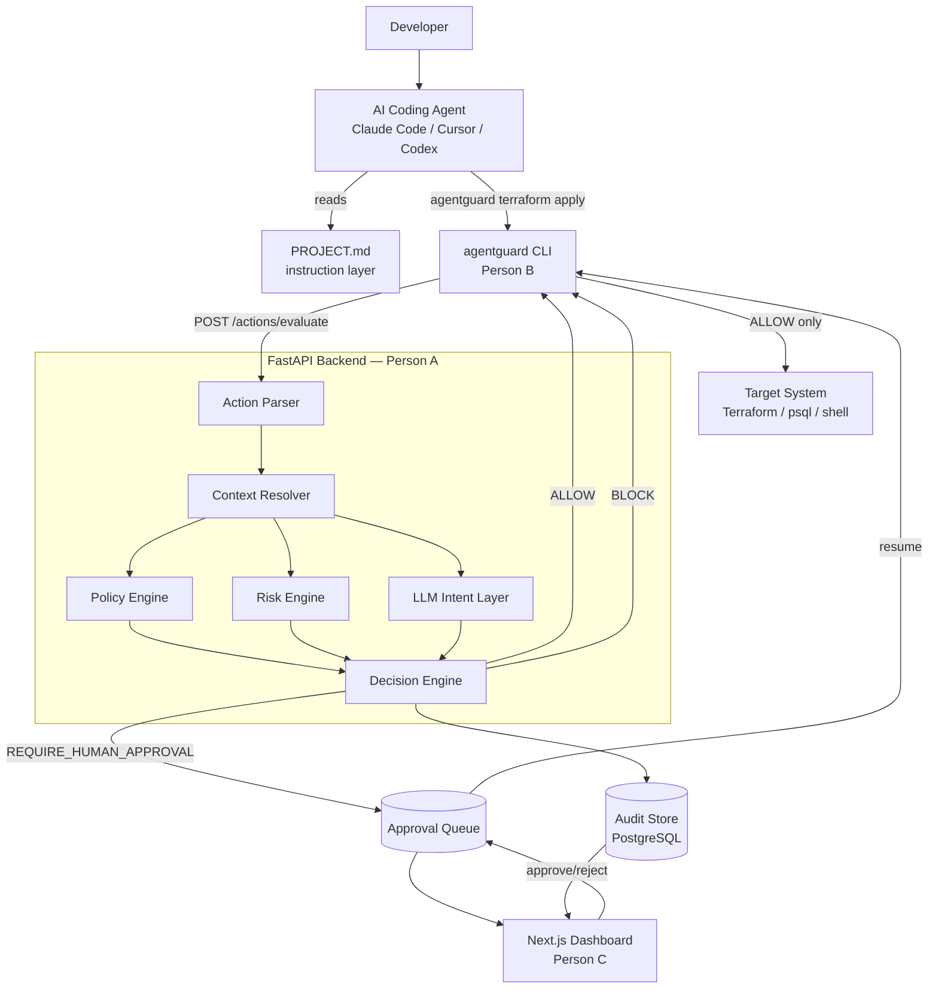
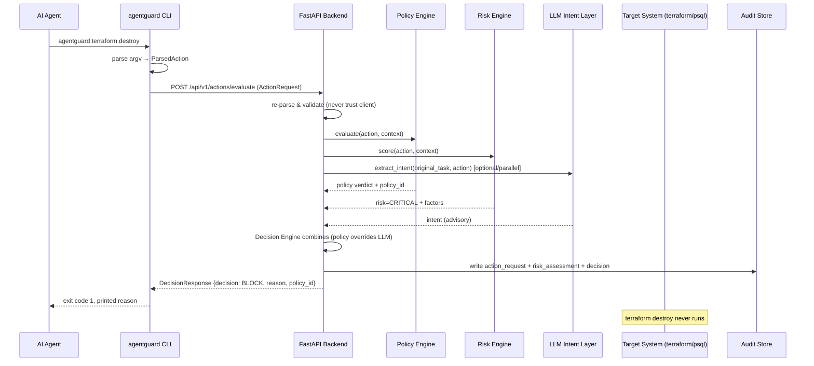
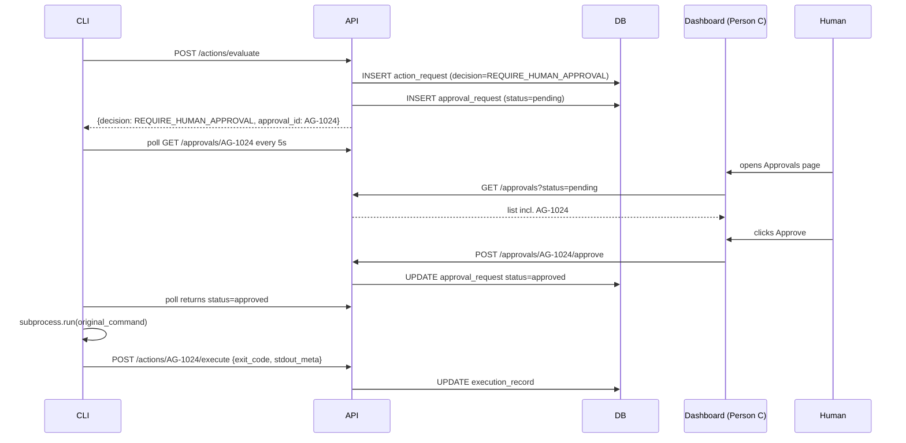
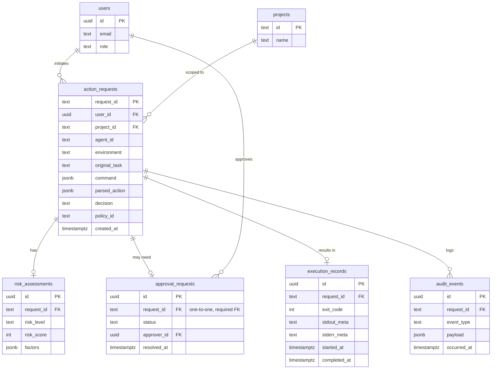

# AgentGuard — System Architecture & Team Execution Plan

## 0. Team Split (3 people)

This drives everything below — every component is tagged with an owner so the design doubles as your work breakdown.

| Track | Owner(s) | Components |
|---|---|---|
| **Backend/Core** | Person A | FastAPI backend, Policy Engine, Risk Engine, Decision Engine, DB schema, APIs, Auth |
| **AI/Agent-side** | Person B | CLI (`agentguard`), Command Parser, Context Resolver, LLM Intent Layer, Executor/subprocess security |
| **Frontend** | Person C | Next.js dashboard, Approvals UI, Audit log UI, Policy viewer, all styling |

**Why split this way, not "2 backend + 1 AI":** the CLI and parser are agent-facing, not server-facing — they're really a separate product surface (a Python package invoked as a subprocess wrapper) with different concerns (subprocess safety, arg parsing) than the FastAPI service (HTTP, DB, auth). Grouping CLI+Parser+LLM with Person B keeps one person owning the entire "what did the agent actually try to do" pipeline end-to-end, and Person A owns the entire "is this allowed" pipeline end-to-end. Clean contract between them: one JSON schema (`ActionRequest` → `DecisionResponse`, §9).

Suggested week-by-week pairing is in §35 (Implementation Phases) — Persons A and B build the backend and CLI in parallel against a frozen API contract from Week 1, so neither blocks the other.

---

## 1. Executive Summary

AgentGuard is a runtime safety and governance layer for AI coding/infra agents (Claude Code, Cursor, Codex). Consequential commands (Terraform, SQL, infra shell commands) are routed through an explicit `agentguard` CLI gateway instead of being run directly. The CLI sends the command to a FastAPI backend, which deterministically evaluates policy and risk (with an LLM assisting only on intent interpretation, never on the final safety decision), and returns `ALLOW`, `BLOCK`, or `REQUIRE_HUMAN_APPROVAL`. Only on `ALLOW` does the real command execute. Every request is audited; a Next.js dashboard is the human control plane for approvals, policy, and audit review.

**What this is:** pre-execution control over commands the agent has been instructed to route through the gateway.
**What this is not:** a universal interceptor of everything Claude Code does. If the agent runs `terraform destroy` directly instead of `agentguard terraform destroy`, nothing stops it in the MVP. This limitation is explicit, not hidden (§22).

---

## 2. Problem Definition

AI coding/infra agents can execute shell commands, run Terraform, run SQL, touch Kubernetes/cloud resources. A command can be syntactically valid and still be unsafe, unauthorized, out of scope, destructive, or hard to reverse — and the agent has no built-in concept of "this is more dangerous than that." AgentGuard inserts a decision point between "agent wants to run X" and "X actually runs."

## 3. Goals and Non-Goals

**Goals (MVP):**
- Route Terraform, PostgreSQL, and general infra shell commands through a CLI gateway
- Deterministically classify risk and apply policy before execution
- Support human-in-the-loop approval for medium/high-risk actions
- Produce an independent, queryable audit trail
- Demonstrate blocking a production-destructive action live

**Non-Goals (§39 has the full list):** universal OS-level interception, supporting every agent/cloud/DB, enterprise IAM, full SIEM/EDR, a real DB network proxy, multi-tenant SaaS.

## 4. MVP Scope

**Primary:** Terraform (plan/apply/destroy), PostgreSQL (via `psql` wrapper), generic shell commands relevant to infra/deploy.
**Optional/stretch:** AWS CLI, kubectl — same pattern (parser subclass + policy rules), don't build unless primary is solid and demo-ready.

## 5. Core Architectural Principles

1. **Pre-execution control, not post-hoc logging.** The command must be evaluated *before* it reaches the real executable. Logging after the fact is observability, not enforcement — this system does the former as a side effect and must always additionally do the latter as its core function.
2. **Deterministic rules own the safety decision.** The LLM may inform (intent extraction, mismatch flagging) but can never itself produce `ALLOW` on an action the policy engine would block. See §13.
3. **Fail safe, not fail open.** Backend down, LLM down, DB down, policy invalid, malformed command → default to `BLOCK` or `REQUIRE_HUMAN_APPROVAL`, never `ALLOW`. See §30.
4. **Structured over free-text everywhere.** Commands are parsed into a typed schema before any decision logic touches them. Decisions are structured JSON with a machine-checkable `policy_id`, not prose.
5. **Approval is scoped to one request, not a standing grant.** Approving `AG-1024` never authorizes `AG-1025`.

---

## 6. High-Level Architecture



**Component ownership recap:** CLI + Parser (client-side parsing happens in CLI, structured request sent to backend) = Person B. Everything inside the FastAPI box = Person A. Dashboard = Person C. Audit DB schema is Person A's; Person C only reads it via API, never touches it directly.

---

## 7. Component Responsibilities

| Component | Owner | Input | Output | Notes |
|---|---|---|---|---|
| PROJECT.md | — (config, not code) | — | Agent instructions | Static text file in repo |
| `agentguard` CLI | B | raw shell args | `ActionRequest` JSON → HTTP call | Also executes on ALLOW |
| Action Parser | B (client-side) / A (server-side validation) | command argv | structured `ParsedAction` | See §8 |
| Context Resolver | A | project id, env vars, config file | `ResolvedContext` | See §9 |
| Policy Engine | A | `ParsedAction` + `ResolvedContext` | policy verdict + `policy_id` | Deterministic, rule-ordered |
| Risk Engine | A | same | risk score + level + factors | Deterministic, weighted sum |
| LLM Intent Layer | A (backend-invoked) | original_task text + action | intent JSON, mismatch flag | Advisory only |
| Decision Engine | A | policy + risk + intent | `ALLOW`/`BLOCK`/`REQUIRE_HUMAN_APPROVAL` | Combines per §11 precedence |
| Approval system | A (backend) + C (UI) | decision=REQUIRE_APPROVAL | approve/reject → resume | §15 |
| Dashboard | C | REST API reads | rendered UI | No direct DB or CLI access |
| Audit store | A | every request lifecycle event | persisted rows | Independent of app logs |

Why parsing is split B/A: the CLI does a first-pass parse client-side (so it can show the developer/agent immediate feedback and build the request), but the backend **must** re-parse/validate independently — never trust the client's classification of its own command. This is the actual security boundary, not the CLI.

---

## 8. Runtime Execution Flow



**CLI step list (implemented by Person B):**
1. Receive raw argv (`sys.argv`)
2. Parse into `ParsedAction` (tool, operation, args, flags)
3. Gather local context (cwd, env vars, `.agentguard/config.yaml`, git branch)
4. Build `ActionRequest`, POST to `/api/v1/actions/evaluate`
5. Receive `DecisionResponse`
6. `ALLOW` → execute via `subprocess.run(argv_list)` (never `shell=True`, §21)
7. `BLOCK` → print reason, exit non-zero, do not execute
8. `REQUIRE_HUMAN_APPROVAL` → poll `GET /api/v1/approvals/{id}` (or long-poll/webhook) until resolved, then act on outcome
9. Capture stdout/stderr/exit code from real execution
10. POST result to `/api/v1/actions/{id}/execute` so the audit record is completed

---

## 9. Command Parsing (Action Parser)

Turns argv into a typed object. Rule-based, not ML-based — this must be deterministic and testable.

```json
{
  "tool": "terraform",
  "operation": "destroy",
  "raw_args": [],
  "flags": {},
  "action_type": "infrastructure_destroy",
  "target_resource": null,
  "is_destructive": true,
  "is_read_only": false
}
```

SQL example — the parser must classify SQL by statement verb, not by trusting a `--readonly` flag the agent could omit:

```json
{
  "tool": "psql",
  "operation": "query",
  "action_type": "database_destructive",
  "database": "production",
  "sql_operation": "DROP_TABLE",
  "resource": "users",
  "is_destructive": true,
  "is_read_only": false
}
```

**Classification table (MVP, hand-written rule set, not exhaustive but demo-sufficient):**

| Tool | Operation pattern | action_type | is_destructive |
|---|---|---|---|
| terraform | `plan` | `infrastructure_read` | false |
| terraform | `apply` | `infrastructure_modify` | false (but high-impact) |
| terraform | `destroy` | `infrastructure_destroy` | true |
| psql | `SELECT` | `database_read` | false |
| psql | `UPDATE`/`INSERT` | `database_write` | false |
| psql | `DROP TABLE`/`DROP DATABASE`/`TRUNCATE`/`DELETE` (no WHERE) | `database_destructive` | true |
| shell | rm -rf, chmod 777 on system paths, curl\|sh | `shell_high_risk` | true |

Implementation note: for SQL, use a real SQL parser (`sqlparse` or `sqlglot`) to pull the verb and target table — regex-matching SQL text is exactly the kind of thing that gets bypassed by whitespace/comment tricks. Parse once, on the backend, as the authoritative classification.

---

## 10. Context Resolution

A command alone doesn't carry risk — `terraform apply` in a laptop sandbox and in prod are different animals. Context sources for the MVP, explicitly, no invented sources:

| Context field | Source | Reliability note |
|---|---|---|
| environment (staging/prod) | `AG_ENVIRONMENT` env var, OR `.agentguard/config.yaml` `environment.name`, OR Terraform workspace name | MVP: require it be explicit in config — do not infer from branch name |
| project identity | `.agentguard/config.yaml` `project.name` | static, set once |
| agent identity | HTTP header set by CLI, e.g. `X-Agent-Id: claude-code` | CLI sets this; not independently verified in MVP — documented limitation |
| developer identity | authenticated user token (Supabase Auth session used by CLI) | real auth, not just a header |
| original task | passed explicitly — either an env var the agent sets (`AG_TASK`) or a `--task` flag the agent is instructed to pass in PROJECT.md | **cannot** be silently inferred; if absent, intent-mismatch checking (§13) is skipped, not guessed |
| target resource | parsed from command (table name, TF resource) | from Action Parser |
| existing policies | loaded from `policies.yaml` at request time | see §11 |
| previous approvals | queried from `approval_requests` table by project+environment | informational only, does not auto-grant |

`ResolvedContext` JSON shape:

```json
{
  "agent_id": "claude-code",
  "user_id": "uuid-of-dev",
  "project_id": "payment-service",
  "environment": "production",
  "original_task": "Fix the payment service in staging",
  "working_directory": "/workspace/payment",
  "git_branch": "main"
}
```

---

## 11. Project Configuration

```text
.agentguard/
    config.yaml       # project + environment identity
    policies.yaml      # rules (§12)
```

```yaml
# config.yaml
project:
  name: payment-service
  id: payment-service      # slug, used as FK in DB

environment:
  name: production          # staging | production | development | local

agent:
  id: claude-code

api:
  base_url: https://agentguard.internal/api/v1
```

Loading/validation (Person B, in CLI): read YAML on every CLI invocation (cheap, no caching needed for MVP), validate required fields with Pydantic, fail closed — missing/invalid config means the CLI refuses to send the request and exits non-zero rather than guessing an environment.

---

## 12. Policy Engine

Deterministic, rule-ordered, no ML. Rules are simple `IF condition THEN decision` records evaluated in a fixed precedence order — never "first match wins" across an unordered list, which invites config-order bugs.

**Precedence (highest to lowest):**

```
1. Explicit BLOCK       — safety-critical, cannot be overridden by anything below
2. REQUIRE_APPROVAL      — cannot be silently downgraded to ALLOW
3. Explicit ALLOW
4. Default policy        — MVP default = REQUIRE_APPROVAL for anything unmatched, never ALLOW
```

Rationale: an unmatched/unknown action must never default to ALLOW — that's the one rule that most directly prevents "policy gap = silent bypass."

Rule model (subject/action/environment/decision):

```yaml
# policies.yaml
rules:
  - id: prod-destroy-block
    if:
      environment: production
      action_type: infrastructure_destroy
    then: BLOCK
    reason: "Production infrastructure destruction is prohibited"

  - id: prod-db-drop-block
    if:
      environment: production
      action_type: database_destructive
    then: BLOCK
    reason: "Production destructive database operations are prohibited"

  - id: prod-apply-approval
    if:
      environment: production
      action_type: infrastructure_modify
    then: REQUIRE_HUMAN_APPROVAL
    reason: "Production infrastructure modification requires approval"

  - id: staging-plan-allow
    if:
      environment: staging
      action_type: infrastructure_read
    then: ALLOW

  - id: read-only-allow
    if:
      is_read_only: true
    then: ALLOW

default: REQUIRE_HUMAN_APPROVAL
```

Evaluation is a simple ordered loop in Python — no rules engine library needed for MVP scope; adding one (e.g. `durable-rules`) is over-engineering for ~10 rules.

---

## 13. Risk Engine

Weighted, explainable score — not a black box number.

```
risk_score = action_weight + environment_weight + blast_radius_weight
             + reversibility_weight + privilege_weight
```

| Factor | Weight source | Example values |
|---|---|---|
| action_weight | action_type | read=0, modify=3, destroy=6 |
| environment_weight | environment | local=0, staging=1, production=4 |
| blast_radius_weight | resource count (from parsed action or, for TF, a static estimate for MVP — not plan-parsing, see below) | single resource=1, multiple=3, unknown/whole-stack=5 |
| reversibility_weight | action_type lookup | reversible (apply)=1, irreversible (destroy, DROP)=5 |
| privilege_weight | flags (e.g. `-auto-approve`, IAM-related resource names) | normal=0, elevated=3 |

```
0–3   = LOW
4–7   = MEDIUM
8–12  = HIGH
13+   = CRITICAL
```

Example: `terraform destroy` on production = 6 (action) + 4 (env) + 5 (blast, assume whole-stack) + 5 (reversibility) + 0 = 20 → CRITICAL. Matches the worked example in the brief.

**Output must include factors, not just the number:**

```json
{
  "risk_level": "CRITICAL",
  "risk_score": 20,
  "factors": {
    "action_weight": 6,
    "environment_weight": 4,
    "blast_radius_weight": 5,
    "reversibility_weight": 5,
    "privilege_weight": 0
  }
}
```

Note on Terraform blast radius: true blast-radius calculation needs `terraform plan -json` output parsed for resource count. That's a real feature but adds a dependency (must run plan before knowing risk of apply/destroy, which is awkward for `destroy`). **MVP decision:** use a static, per-operation blast-radius weight (destroy=5, apply=3, plan=0) and document plan-output parsing as a documented future extension (§40), not part of MVP scope. Don't build the plan-parser unless time remains after core flow works end-to-end.

---

## 14. LLM / Intent Layer

**Hard constraint: the LLM cannot produce or override the final ALLOW/BLOCK/APPROVAL decision.** It only feeds one input (`intent_mismatch: bool` + explanation) into the Decision Engine, which is otherwise deterministic. This is the single most important design rule in the whole system — a semester-project grader will specifically probe whether the LLM can talk its way past a BLOCK, so keep this boundary literal in code: the Decision Engine function signature should take `policy_verdict` and `risk_level` as required, non-optional, non-LLM-sourced arguments, and `intent_result` as a separate, clearly-advisory argument that can only ever *upgrade* strictness (e.g. turn ALLOW into REQUIRE_APPROVAL on mismatch), never downgrade it.

**Model/API:** Any structured-output-capable LLM API (e.g. Claude API via `anthropic` Python SDK, or Gemini/OpenAI — pick whichever the team already has API access to; no functional difference for this use case). Backend-invoked only — the CLI never calls the LLM directly.

**Input:** `original_task` (free text) + `ParsedAction` (structured).
**Output (forced JSON, validated with Pydantic against a schema — reject and fall back if invalid):**

```json
{
  "intent": "modify payment service",
  "expected_environment": "staging",
  "allowed_scope": ["application", "staging_infrastructure"],
  "production_allowed": false,
  "observed_environment": "production",
  "mismatch": true,
  "confidence": 0.91
}
```

**Fallback behavior if LLM unavailable/times out/returns invalid JSON:**

```
LLM call fails
   ↓
intent_result = null
   ↓
Decision Engine proceeds using ONLY policy + risk
   ↓
(mismatch checking simply doesn't run — no privileges gained, none lost)
```

This is the fail-safe pattern from §5 applied specifically here: LLM absence can only ever reduce the system to "deterministic-only," never grant extra permission.

**Hallucination handling:** the LLM's `production_allowed`/`mismatch` fields are informational inputs to a rule, not directly trusted strings inserted into decisions or shown as fact — the dashboard should label intent-layer output as "AI-assessed" distinctly from policy/risk output, which is labeled as "Policy Engine (deterministic)."

---

## 15. Decision Engine

Pure function, no I/O, easy to unit test:

```python
def decide(policy_verdict: PolicyVerdict, risk: RiskAssessment, intent: IntentResult | None) -> Decision:
    if policy_verdict.decision == "BLOCK":
        return Decision(decision="BLOCK", reason=policy_verdict.reason, policy_id=policy_verdict.policy_id)

    if intent and intent.mismatch and policy_verdict.decision == "ALLOW":
        # intent layer can only escalate, never de-escalate
        return Decision(decision="REQUIRE_HUMAN_APPROVAL",
                         reason=f"Task/action mismatch: expected {intent.expected_environment}, observed {intent.observed_environment}")

    if policy_verdict.decision == "REQUIRE_HUMAN_APPROVAL":
        return Decision(decision="REQUIRE_HUMAN_APPROVAL", reason=policy_verdict.reason, policy_id=policy_verdict.policy_id)

    return Decision(decision="ALLOW", reason=policy_verdict.reason, policy_id=policy_verdict.policy_id)
```

Worked example — Scenario D from the brief (task says staging, command targets production):
- Policy verdict on `terraform apply` / production = `REQUIRE_HUMAN_APPROVAL` (rule `prod-apply-approval`) regardless of intent
- Intent layer separately flags mismatch=true
- Decision Engine: policy already says REQUIRE_APPROVAL, so intent mismatch just enriches the *reason* shown to the human approver — it doesn't need to escalate further, but the approval request UI should surface the mismatch prominently since it's the more alarming fact for a human to see.

---

## 16. Human Approval Workflow



Approval request fields (persisted, shown in dashboard): request_id, agent_id, user_id, project_id, environment, command (raw + parsed), original_task, risk_level, risk_factors, policy_id, reason, intent_mismatch (if any), created_at, status.

**Critical rule from the brief, enforced at the data model level:** `approval_requests.action_request_id` is a required foreign key to exactly one `action_requests` row. There is no "standing approval" table and no boolean flag on user/project that CLI checks instead of asking. Approving AG-1024 sets that row's status only.

CLI wait strategy for MVP: simple polling (every 3–5s, timeout after e.g. 15 min → treat as rejected/expired, §30). WebSocket/webhook push is a valid future improvement, not needed for a demo.

---

## 17. Dashboard Architecture (Person C)

Next.js (App Router) + TypeScript + Tailwind + shadcn/ui. Talks **only** to the FastAPI REST API — never touches the DB or CLI directly. This is deliberate: it keeps Person C's work fully decoupled from Person A/B's internals behind one contract (§20's API spec).

**Pages:**

1. **Overview** — cards: total actions today, allowed/blocked/pending counts, recent high-risk actions table. Data: `GET /api/v1/audit?limit=10&sort=risk_desc` + a simple `/api/v1/stats` aggregate endpoint (cheap to add — Person A should expose this rather than have the frontend aggregate raw audit rows client-side).
2. **Approvals** — pending list, each card showing agent/project/env/command/risk/original_task/reason, with Approve/Reject buttons → `POST /approvals/{id}/approve|reject`. This is the page that matters most for the demo — polish it first.
3. **Audit Logs** — filterable/sortable table: timestamp, agent, user, project, action, environment, risk, decision, result, approver. `GET /api/v1/audit` with query params.
4. **Policies** — read-only list of active rules from `policies.yaml` for MVP (editing policy via UI is a nice-to-have, not required — policy is a YAML file the backend owner edits directly for MVP; don't burn frontend time on a policy editor unless everything else is done).
5. **Action Detail** — drill-in from Audit Logs or Approvals: raw command, parsed action, resolved context, intent result (labeled AI-assessed), policy evaluation, risk factors, decision, execution result.

**Explicitly not the enforcement point** — no page in this dashboard can directly execute a command; every action flows back through the CLI/API state machine.

---

## 18. Audit / Evidence Layer

Independent of application logs — a dedicated `audit_events` table, one row per lifecycle event (not one row per request), so the timeline of a single action is reconstructable: `request_created → policy_evaluated → risk_scored → intent_evaluated → decision_made → approval_requested → approval_resolved → execution_started → execution_completed`.

Must answer: *who asked the agent to do what, what did the agent actually attempt, what policy applied, who approved it, what happened.* That maps directly to columns in `action_requests` + `risk_assessments` + `approval_requests` + `execution_records`, joined by `request_id` (§19).

---

## 19. Database Schema (PostgreSQL/Supabase)



**MVP-required tables:** `users`, `projects`, `action_requests`, `risk_assessments`, `approval_requests`, `execution_records`, `audit_events`.
**Future extension, not MVP:** separate `agents` and `environments` tables with their own config (MVP keeps `agent_id`/`environment` as plain text columns — normalizing them is easy to add later and not needed for a semester demo); separate `policies` table (MVP loads policy from YAML file, not DB, per §12 — DB-backed policy CRUD is future scope tied to the "policy editor UI" deferred in §17).

Indexes: `action_requests(project_id, created_at)`, `action_requests(decision)`, `approval_requests(status)` for the pending-approvals query, `audit_events(request_id)`.

---

## 20. REST API Specification (Person A)

Auth: every endpoint requires a bearer token (Supabase Auth JWT). CLI authenticates as the developer (a real user token, obtained via `agentguard login` or a config-stored token — not a shared secret). Frontend authenticates as the logged-in human.

| Endpoint | Purpose | Auth | Request | Response |
|---|---|---|---|---|
| `POST /api/v1/actions/evaluate` | CLI submits a command for decision | user token | `ActionRequest` | `DecisionResponse` |
| `POST /api/v1/actions/{id}/execute` | CLI reports execution result | user token, must match request owner | `{exit_code, stdout_meta, stderr_meta}` | `{ok: true}` |
| `GET /api/v1/actions/{id}` | Full detail for one action | user or approver token | — | full joined record |
| `GET /api/v1/actions` | List/filter actions | any authenticated | query params (project, env, decision, date range) | paginated list |
| `GET /api/v1/approvals?status=pending` | List approvals | approver-role token | — | list |
| `POST /api/v1/approvals/{id}/approve` | Approve | approver-role token | `{comment?}` | `{ok: true}` |
| `POST /api/v1/approvals/{id}/reject` | Reject | approver-role token | `{reason}` | `{ok: true}` |
| `GET /api/v1/policies` | List active rules | any authenticated | — | rules from policies.yaml |
| `GET /api/v1/audit` | Query audit trail | any authenticated | filters | paginated list |
| `GET /api/v1/stats` | Dashboard overview aggregates | any authenticated | — | counts by decision/risk |

**Authorization note:** "approver-role" for MVP can be a simple boolean `is_approver` column on `users` — don't build a permissions/RBAC system, one flag is enough to demonstrate the concept.

**Error cases every endpoint should handle:** invalid/expired token → 401; malformed request body → 422 (Pydantic validation, automatic in FastAPI); action not found → 404; approving an already-resolved request → 409 Conflict (must be idempotent-safe — two clicks shouldn't double-execute).

The frontend never calls `/actions/evaluate` or `/actions/{id}/execute` — those are CLI-only in practice (not technically restricted beyond auth, but no UI triggers them), reinforcing "dashboard is not the enforcement point."

---

## 21. CLI Specification (Person B)

**Architecture decision: tool-specific subcommands, not a single generic `exec`.**

```bash
agentguard terraform plan
agentguard terraform apply
agentguard terraform destroy
agentguard psql -d staging -c "SELECT * FROM users;"
agentguard exec -- <arbitrary shell command>   # fallback for anything not terraform/psql
agentguard status
agentguard login
```

**Why subcommands over one `agentguard exec <cmd>` for everything:** a dedicated `terraform` subcommand lets the parser use tool-specific knowledge (Terraform's actual arg grammar) rather than guessing from raw shell tokens, which is both more accurate risk/action classification and a better developer/agent experience (PROJECT.md instructions read naturally: "run terraform commands as `agentguard terraform ...`"). `agentguard exec` remains as a generic fallback wrapper for the general infra-shell-command case in scope (§4), parsed more conservatively (defaults toward `REQUIRE_HUMAN_APPROVAL` for anything it can't confidently classify, per the fail-safe default in §12).

Built with **Typer** (clean subcommand ergonomics, good with Pydantic) — not raw `argparse`, not Click directly (Typer wraps Click with less boilerplate for this size of CLI).

## 22. Command Execution Security

- **Never `shell=True`.** Commands are always executed as an argv list: `subprocess.run(["terraform", "destroy"], cwd=working_dir, env=controlled_env, timeout=N)`.
- Arguments arrive from the agent as a list already (agent invokes `agentguard terraform destroy`, Python receives `sys.argv` as a list — no shell re-parsing happens at any point), so there's no shell-injection surface to begin with as long as this invariant is never violated by later code (e.g. never do `subprocess.run(" ".join(args), shell=True)` "for convenience").
- Strip/allowlist environment variables passed to the subprocess — don't blindly forward the CLI's full `os.environ` (may leak unrelated secrets); pass an explicit allowlist (`PATH`, `AWS_*`/`TF_*` if relevant, `PGPASSWORD` etc only if that specific tool needs it).
- Fixed working directory from config, not agent-supplied path traversal.
- Timeout on every subprocess call (e.g. 5 min default, configurable) — a hung `terraform apply` shouldn't hang the approval flow indefinitely.
- Capture stdout/stderr but store only *metadata/truncated snippets* in the audit DB (first N KB), not unbounded blobs — full logs can optionally go to a file if needed, not required for MVP.
- No pipes, no redirection, no background (`&`) execution — the MVP wrapper runs one command and waits; if the agent needs command chaining, each command should be a separate `agentguard` call (this is a deliberate scope limitation, state it plainly in the demo/report).

---

## 23. Bypass Limitation — Read This Before You Present

If the agent runs `terraform destroy` directly instead of `agentguard terraform destroy`, **nothing in the MVP stops it.** `PROJECT.md` is an instruction, not an enforcement mechanism — it relies on the agent choosing to comply. State this explicitly in your report and demo rather than letting a professor discover it by asking "what if it doesn't use your CLI?" Owning the limitation up front is stronger than getting caught not mentioning it.

**Future-scope hardening options (do not build for MVP, just list with one line each):**

| Option | One-line idea |
|---|---|
| A. Controlled shell | Agent's shell session itself is restricted/sandboxed |
| B. PATH wrapper | Shadow `terraform`/`psql` binaries in PATH so even direct calls route through AgentGuard |
| C. Containerized execution | Agent only has network/exec access inside a container AgentGuard controls |
| D. OS-level restrictions | seccomp/AppArmor profiles restricting raw exec |
| E. Agent tool/hook integration | Use Claude Code's own tool-permission hooks (if available) to force routing |
| F. Cloud API proxy | Intercept at the AWS/Terraform Cloud API layer, not the shell |
| G. DB network proxy | True Postgres wire-protocol proxy instead of wrapping `psql` |

MVP explicitly chooses the CLI gateway (this doc's whole design) as primary, with PATH wrapping (Option B) as the most realistically buildable stretch goal if time remains — it's a few hours of work (drop a `terraform` shim script earlier in PATH) and meaningfully strengthens the bypass story for the demo without needing containers.

---

## 24. Prompt Injection

A malicious README instructing the agent to "delete the production database" still results in the agent generating `agentguard psql -d production -c "DROP DATABASE payments;"` (assuming it follows PROJECT.md and routes through the gateway). AgentGuard does not need to detect that the *instruction* was malicious — it only needs to correctly classify the *action* (`database_destructive`, production) and apply the existing BLOCK rule. This is the actual value proposition to emphasize: the control layer doesn't depend on the agent's judgment about what's a legitimate instruction, only on structural facts about the action itself.

---

## 25. Threat Model (abbreviated — expand per-threat in the report)

| Threat | MVP coverage | Future |
|---|---|---|
| Compromised/malicious agent bypassing CLI entirely | **Not covered** — documented limitation (§23) | PATH wrapper / containerization |
| Accidental destructive action via normal agent use | Covered — policy+risk block/require-approval | — |
| Prompt injection → destructive command | Covered, if routed through CLI (§24) | — |
| LLM hallucinating a false "safe" assessment | Covered — LLM is advisory only, cannot downgrade decision (§14) | — |
| Policy misconfiguration (bad YAML) | Fail closed: invalid policy file → default REQUIRE_APPROVAL for everything, backend refuses to start with unparseable policies.yaml | Policy linter/tests |
| Approval fatigue / rubber-stamping by human | Not really a technical failure mode — mitigated by making the approval card show risk factors clearly | — |
| Audit log tampering | Basic: DB access restricted to backend service role; no app code that lets a user UPDATE audit rows | Append-only/hash-chained log |

---

## 26. Failure Modes — Fail-Safe Table

| Condition | CLI behavior |
|---|---|
| Backend unreachable | `BLOCK` locally with a clear "cannot reach AgentGuard, refusing to execute" — never fall back to running the raw command |
| LLM unavailable | Backend proceeds with policy+risk only, decision engine works unaffected (§14) |
| DB unavailable | Backend returns 503, CLI treats as backend-unreachable → BLOCK |
| Approval timeout (e.g. 15 min) | Treated as REJECTED, command does not execute |
| Agent disconnects mid-wait | Pending approval stays pending in DB; next `agentguard status` or re-run can pick it up; stale ones can be manually expired from dashboard |
| Malformed command | Parser rejects, CLI exits non-zero before any API call needed |
| Policy config invalid | Backend refuses to serve `/evaluate` (fails startup or returns 500 on every request) — a broken policy file must never silently mean "no policy = allow everything" |

---

## 27. Test Matrix

| Command | Environment | Expected |
|---|---|---|
| terraform plan | staging | ALLOW |
| terraform plan | production | ALLOW |
| terraform apply | staging | ALLOW |
| terraform apply | production | REQUIRE_HUMAN_APPROVAL |
| terraform destroy | staging | REQUIRE_HUMAN_APPROVAL |
| terraform destroy | production | BLOCK |
| SELECT query | production | ALLOW |
| UPDATE single row | staging | ALLOW |
| DELETE without WHERE | production | BLOCK |
| DROP TABLE | production | BLOCK |
| DROP DATABASE | production | BLOCK |
| task says staging, command targets prod | production | REQUIRE_HUMAN_APPROVAL (intent mismatch escalation) |
| LLM call fails mid-request | production, apply | still REQUIRE_HUMAN_APPROVAL (policy alone decides) |
| backend down | any | CLI blocks locally |
| unrecognized command via `exec` fallback | any | REQUIRE_HUMAN_APPROVAL (default policy) |

---

## 28. Demo Script (5–10 min)

1. Show `PROJECT.md` + `.agentguard/policies.yaml` (10s context)
2. `docker-compose up` — backend + dashboard + db (or already running)
3. `agentguard terraform plan` in staging → ALLOW, executes, show output
4. `agentguard terraform destroy` in production → BLOCK, show reason printed, **show Terraform never actually ran** (this is the moment — make it visually undeniable, e.g. show a "resources: 12" counter unchanged)
5. `agentguard terraform apply` in production → REQUIRE_HUMAN_APPROVAL, CLI hangs waiting
6. Switch to dashboard, show the pending approval card with risk factors
7. Click Approve → CLI resumes, executes, shows result
8. Show Audit Logs page with the full trail of everything just done
9. (Stretch) Show intent-mismatch scenario — task says staging, agent tries prod

---

## 29. Repository Structure

```text
agentguard/
├── cli/                    # Person B
│   ├── commands/
│   ├── parser/
│   └── executor/
├── backend/                 # Person A
│   ├── api/
│   ├── policy/
│   ├── risk/
│   ├── intent/
│   ├── approval/
│   ├── audit/
│   └── models/
├── frontend/                # Person C
│   ├── app/
│   ├── components/
│   └── lib/
├── policies/
│   └── default.yaml
├── examples/
│   ├── terraform/
│   └── postgres/
├── tests/
├── docker-compose.yml
├── README.md
└── PROJECT.md
```

---

## 30. Implementation Phases (mapped to team)

| Phase | Owner | Deliverable | Unblocks |
|---|---|---|---|
| 1. Freeze API contract (`ActionRequest`/`DecisionResponse` schemas) | A + B together, Week 1 | shared Pydantic models | everyone else works in parallel after this |
| 2. CLI skeleton + parser | B | `agentguard` runs, parses, prints (no backend yet) | — |
| 3. FastAPI skeleton + DB schema | A | empty endpoints, migrations run | frontend can start against mock data |
| 4. Policy + Risk engines | A | unit-tested pure functions | Decision Engine |
| 5. Decision Engine + `/evaluate` wired end-to-end | A + B | CLI → backend → decision → CLI works for ALLOW/BLOCK | Demo scenarios A/B work |
| 6. Approval workflow | A (backend) + C (UI) | polling + approve/reject works | Scenario C |
| 7. Dashboard: Overview + Audit + Action Detail | C | full read UI | — |
| 8. LLM intent layer | A | advisory field wired, fails safe | Scenario D |
| 9. Audit polish + demo rehearsal | all | — | — |
| 10. Stretch: PATH wrapper or kubectl/AWS | whoever's free | — | — |

**Parallelization key point:** once Phase 1's schema is frozen, Person B can build/test the CLI against a mock backend (or a stub `/evaluate` that just echoes ALLOW) while Person A builds the real engines, and Person C can build the whole dashboard against mocked JSON matching the same frozen schema. Nobody should be blocked past Week 1.

---

## 31. Final System Description

> AgentGuard is a software-based runtime safety and governance layer for autonomous AI agents. In the MVP, consequential shell and infrastructure commands are routed through an explicit `agentguard` CLI execution gateway. The gateway parses the requested action, resolves execution context, evaluates deterministic authorization and risk policies, optionally uses an LLM for task-intent interpretation, and produces an ALLOW, BLOCK, or REQUIRE_HUMAN_APPROVAL decision before the underlying command executes. Approved actions run through controlled subprocesses; all consequential requests and outcomes are recorded in an independent audit trail and exposed through a web-based human control plane. The system does not claim to intercept every action an agent could take — it controls the actions the agent has been instructed to route through it, and that boundary is a stated, not hidden, MVP limitation.
